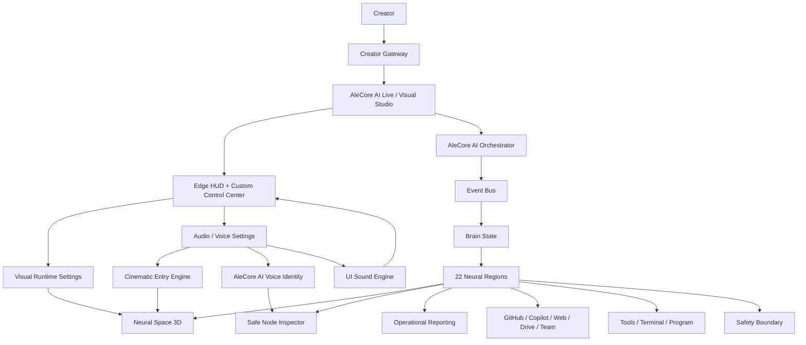
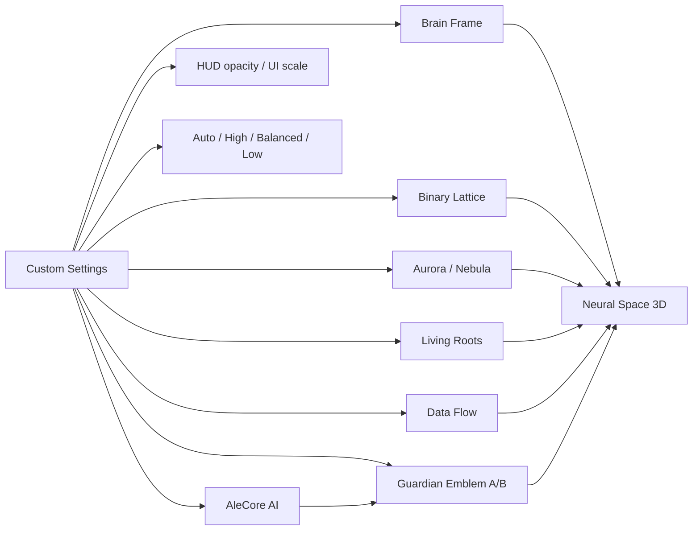
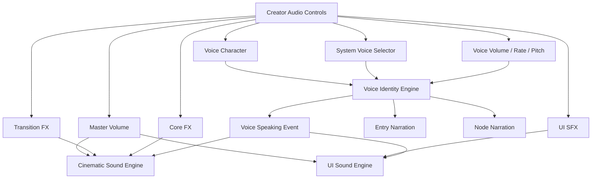
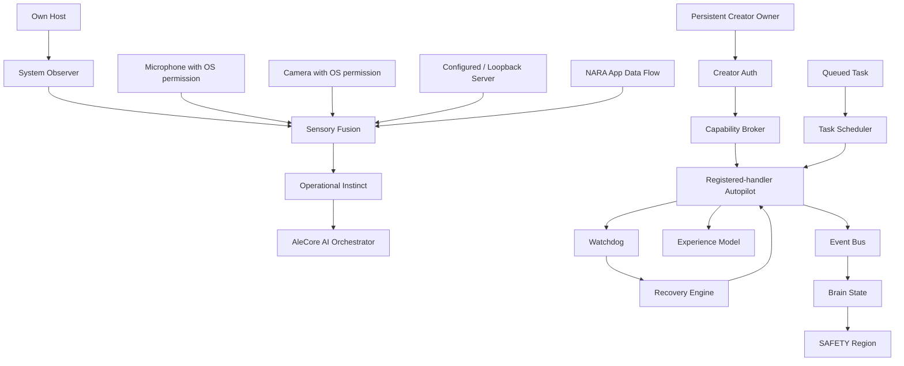

# AleCore AI System Architecture

Status: Release-candidate architecture through R7 Voice Identity / UI Sound.

## 1. System overview



## 2. AleCore AI brain

The core brain is event-driven. `NaraOrchestrator` owns the Event Bus and Brain State. Events update region state; the Studio observes the resulting snapshot and telemetry.

### Neural regions

| Group | Regions |
| --- | --- |
| Core | NARA_CORE |
| Cognitive | REASONER, PLANNER, MEMORY, BUG_HUNTER, AGENT_MANAGER |
| Execution | TOOLS, TERMINAL, PROGRAM, ERROR_MONITOR |
| Connection | GITHUB, COPILOT, WEB, TEAM, PR, SYNC, ONLINE, OWNER_EMAIL, DRIVE |
| Workflow | REPORTING, FOLLOW_UP |
| Safety | SAFETY |

Total: **22 neural regions**.

Core topology begins with `NARA_CORE` connected directly to Reasoner, Planner, Memory, Agent Manager, Safety and Follow Up. The remaining regions form execution, connection and reporting paths around that center.

## 3. AleCore AI Visual / Live Studio

```text
nara-core/studio/
├── server.mjs                    # localhost Studio server + authenticated API/SSE
├── WINDOWS_GPU_ACCEPTANCE.md     # target-machine acceptance
└── public/
    ├── app.js                    # Studio composition / runtime wiring
    ├── creator-gateway.js        # Creator authentication UI
    ├── creator-brain.js          # binary neural Creator backdrop
    ├── edge-hud.js               # fullscreen operational HUD
    ├── neural-space.js           # Three.js neural renderer
    ├── matrix-transition.js      # binary matrix transition
    ├── neural-entry.js           # cinematic entry sequencing
    ├── cinematic-sound.js        # transition/Core synthesized audio
    ├── custom-settings.js        # bounded visual/audio preferences
    ├── node-inspector.js         # safe region metadata inspector
    ├── node-voice.js             # sanitized region narration
    ├── voice-identity.js         # R7 system voice + character profiles
    ├── ui-sound.js               # R7 local UI SFX engine
    ├── styles.css                # holographic Studio UI
    └── index.html                # Studio surface
```

## 4. Visual runtime



Current visual properties include:
- luminous dual-layer brain frame
- 3D binary lattice
- galaxy / nebula / aurora environment
- 48 living-root links in the current topology rendering
- realtime semantic route packets
- AleCore AI energy shell
- two counter-rotating Guardian Emblem rings
- adaptive quality and reduced-motion support
- Explorer / Focus / Core navigation

## 5. Audio and voice architecture



### R7 voice characters

- **AleCore Deep** — lower/slower
- **AleCore Calm** — relaxed, less synthetic
- **AleCore Droid** — low pitch with Droid Character enabled
- **AleCore Natural** — closer to the selected operating-system voice

The System Voice selector enumerates the Speech Synthesis voices actually exposed by Windows/Edge/Electron. Indonesian voices are preferred automatically when available. A selected `voiceURI` is stored only as a local preference.

### UI SFX

Local Web Audio cues:
- hover
- click
- panel open
- panel close
- confirm / success
- warning
- error
- process
- neural pulse

No remote sound files are required.

## 6. Security boundaries

- Creator password is server-side only.
- Creator sessions use bounded HttpOnly cookies.
- Visual/audio preferences may use localStorage; credentials do not.
- Camera/microphone remain browser/OS permission controlled.
- No permission bypass.
- No arbitrary network discovery.
- No arbitrary shell from the renderer.
- Region inspector exposes an explicit safe metadata projection only.
- Node narration uses sanitized operational metadata.
- Passwords, API keys, bearer tokens, raw environment secrets and private reasoning are not exposed by the Studio UI.
- Physical GPU acceptance rejects software renderers when hardware mode is requested.

## 7. Development history

### Foundation
- 22-region AleCore AI brain topology
- Event Bus
- Brain State
- AleCore AI Orchestrator
- operational events / connections / work lifecycle

### Redesign Stage 1 — Creator Gateway
- authenticated Creator entry
- capability matrix
- browser permission-safe camera/mic probing

### Stage 2 — Edge HUD
- fullscreen Neural Space primary surface
- connection/loading/error/progress/evolution/damage monitors

### Stage 3 — Cinematic entry
- neural transition sequence
- local Web Audio
- Indonesian Speech Synthesis cue

### Stage 4 — Galactic brain
- galaxy frame
- aurora / nebula
- centered Neural Space composition
- adaptive quality

### Stage 5 — Neural inspector
- explorable nodes
- authenticated safe metadata endpoint
- topology navigation

### Stage 6 — Operational node voice
- sanitized spoken node/Core summaries
- visible transcript
- replay control

### Revision R1
- Creator neural binary brain

### Revision R2
- matrix warp transition
- sweep / zoom / process / pulse / flow audio

### Revision R3
- mechanical Core
- two counter-rotating protection rings

### Revision R4
- Custom Visual Control Center
- brighter dark-room brain frame
- 3D binary lattice
- broken/angular living roots
- Guardian Emblem rings
- visual presets and realtime tuning

### Revision R5
- bounded voice/audio profile
- lower/slower Droid character
- Master / Transition / Voice controls
- local voiceBoot cue

### Revision R6
- release-candidate Windows acceptance
- physical GTX 1650 + R4/R5 gate validation
- full CI + target-machine evidence

### Revision R7
- selectable Windows/Edge system voice
- AleCore Deep / Calm / Droid / Natural profiles
- Preview Voice
- UI SFX level
- Core FX level
- dedicated local UI Sound Engine
- automatic SFX/Core ducking while AleCore AI is speaking

## 8. Acceptance layers

```text
Source / static tests
        ↓
HumanALE root tests + build
        ↓
AleCore Cloud / database security tests
        ↓
Realtime Electron WebGL smoke
        ↓
R4/R5/R7 runtime control checks
        ↓
Windows physical GPU acceptance
        ↓
Subjective visual + voice review
        ↓
Ready for Review
        ↓
Merge only by explicit release decision
```

## 9. Current release discipline

PR #122 remains a stacked Draft release candidate until the latest voice/UI-sound revision completes automated and physical review. Passing CI does not automatically merge the PR.


## 10. AleCore AI Engine V2.1



### V2.1 identity and ownership

NARA has a stable Core identity and a persistent per-device Creator Owner Store.

The Owner Store keeps an immutable owner ID and device ID plus a salted scrypt password verifier. Plaintext passwords are not persisted. Credential changes require an authenticated Creator session and the existing password; changing credentials invalidates existing sessions.

The standalone NARA Studio fails closed until an owner/password is provisioned. Once provisioned, the owner store survives restart.

### V2.1 sensory fusion

The Core can fuse these bounded channels:

- hearing energy and frequency bands
- vision activity
- speech activity
- own-host system health
- configured / loopback server state
- application-owned inbound/outbound data flow
- permissioned device integration

Own-host telemetry is limited to platform, release, architecture, hostname, CPU load, memory use, NARA process RSS and the IP addresses assigned to the host interfaces. MAC addresses are deliberately omitted.

### V2.1 Capability Broker

Sensitive operations are mediated by an explicit broker. Capabilities may require Creator approval, OS permission, or both.

The architecture does **not** provide capabilities for credential bypass, authentication bypass, root exploits, exploit-based privilege escalation, arbitrary network discovery, packet capture or hidden persistence.

Administrative OS operations are modeled as `os.privileged.action` and require both Creator approval and the operating system's confirmation/elevation path.

### V2.1 safe autopilot

The autopilot cannot accept arbitrary shell strings. It executes only handler functions registered by the trusted runtime.

A task may specify:
- priority
- dependencies
- registered handler
- optional required capability

Capability-protected tasks remain blocked/queued until the required authorization is present.

### V2.1 watchdog and recovery

The watchdog tracks task heartbeats and bounded timeouts. Recovery is policy-based:

- bounded retries for runtime failures
- exponential bounded retry delay
- authentication, permission and policy failures escalate
- exhausted retries may use an explicitly available fallback
- otherwise the task is escalated for human/Creator attention

### V2.1 operational instinct

The Instinct Engine is not hidden reasoning. It exposes bounded operational signals:

- urgency
- risk
- attention
- confidence
- named anomalies

Inputs currently include CPU saturation, memory pressure, server health, failures, stalled tasks and sensory activity.

### V2.1 adaptive experience

The Experience Model records success/failure only for safe strategy IDs provided by the runtime. It can prefer a better-scoring registered strategy, but does not alter source code, model weights, credentials, permission policy or the capability boundary by itself.

### V2.1 skill registry

The Core currently exposes at least 19 operational skills, including:

- Reasoning
- Planning
- Memory Read / Write
- Agent Manager
- Program Execution
- Verification
- Bug Analysis
- Synchronization
- Hearing Sensor
- Vision Sensor
- System Observer
- Configured Server Observer
- NARA Data Flow Observer
- Device Integration
- Capability Guard
- Autopilot Control
- Watchdog Monitor
- Recovery Decision

### V2.1 security principle

NARA may integrate deeply with a device only through capabilities that the device and Creator permit. "Deep integration" means learning the host profile, using approved adapters, reading its own runtime state and calling explicit APIs. It does not mean bypassing the host security model.


## 11. NARA + HumanALE Unified Runtime V3

V3 makes the boundary explicit:

```text
CREATOR
   │
   ▼
OWNER / SAFETY
   │
   ▼
NARA CORE ENGINE  ← brain / goals / reasoning / memory / skills / safety
   │
   ▼
UNIFIED RUNTIME HOST
   │
   ├── HumanALE body / avatar / voice / hearing / vision
   ├── Agent Coordinator → Agent Hub → Codex / Copilot / supported executors
   └── Visual / Live Studio control surfaces
```

AleCore AI is the authoritative brain. HumanALE is the embodied desktop surface. Visual Studio is a monitor/control surface rather than a second brain.

### V3.1 — HumanALE Runtime Host

`desktop/humanale-runtime-host.mjs` centralizes the desktop/Core bridge.

It preserves the legacy channels:
- `dudidam:nara-state`
- `dudidam:nara-voice`

It adds:
- `dudidam:runtime-state`
- `dudidam:runtime-snapshot`

The unified snapshot contains:
- complete AleCore AI state
- HumanALE body state
- runtime contract / authority projection
- bounded sensory projection

HumanALE body state is derived from authoritative Core state:
- idle
- listening
- thinking
- working
- speaking
- warning

### V3.2 — Goal → Agent Coordinator → Agent Hub

`desktop/nara-agent-coordinator.mjs` routes HumanALE developer work through NARA instead of calling the Agent Hub directly.

```text
HumanALE request
      ↓
NARA Goal Manager
      ↓
Task Scheduler
      ↓
Registered Autopilot Handler
      ↓
Agent Hub
      ↓
Codex / GitHub Copilot / supported worker
      ↓
Verification
      ↓
Goal reconciliation
      ↓
Experience + Metacognition
```

Prompt and approved memory-context packets stay in process memory only while the coordinated task is running. They are not copied into Goal or Experience persistence.

Agent Hub safety boundaries remain active:
- analyze mode is read-only
- work mode is restricted to the selected project checkout
- no automatic git push
- no automatic merge
- no automatic publish
- no credential mutation

### V3.3 — End-to-end Electron acceptance

Desktop CI smoke now checks the complete renderer-to-Core loop:
- renderer obtains Runtime V3 snapshot
- NARA identity is present
- HumanALE role is `nara-body`
- audio sensory input reaches Core
- speech state returns as HumanALE `speaking`
- forbidden renderer memory-write event is rejected
- detached panel still loads

### V3.4 — Unified Runtime Contract

`nara-core/runtime/unified-contract.js` is the canonical renderer/Core contract.

Renderer input is restricted to:
- `audio.energy`
- `vision.frame`
- `vision.stop`
- `speech.start`
- `speech.energy`
- `speech.stop`
- `brain.region.select`

The contract:
- clamps sensory numeric values
- strips unrecognized fields
- bounds text fields
- rejects invalid brain regions
- rejects oversized renderer envelopes
- does not expose arbitrary shell, authentication bypass or root-exploit actions

High-impact actions remain outside this renderer contract.

### V3.5 — Shared Creator Gate

HumanALE desktop and NARA Studio use the same persistent owner-store path by default:

```text
NARA_OWNER_STORE
or
~/.nara/owner.json
```

The desktop Creator Gate provides:
- first-run Creator provisioning
- bounded login session
- login attempt rate limiting
- global desktop lock
- Creator credential rotation
- session revocation after credential change
- shared owner identity with Studio

Passwords:
- are sent only to the Electron main process for verification
- are not stored in localStorage
- are not included in Runtime V3 snapshots
- are not written into NARA memory
- are stored on disk only as the existing salted scrypt verifier

Creator unlock is required for:
- AI/provider calls and provider login
- AleCore Cloud context access
- Agent Hub / Codex / Copilot
- project-root changes
- terminal operations
- microphone/camera/system-audio permission paths
- NARA renderer sensory dispatch and Runtime snapshots

Window-only controls such as hide/close/move remain available while locked so the user can safely dismiss the application.

### V3.6 — Unified Physical Acceptance

`HumanALE-Unified-Acceptance.bat` runs a one-click Windows acceptance sequence:

1. locked dependency / Electron preparation
2. HumanALE desktop `--ci-smoke`
3. Creator Gate + Unified Runtime smoke
4. NARA Neural physical GPU acceptance
5. combined JSON evidence
6. final PASS / FAIL

Evidence:
- `artifacts/humanale-unified-acceptance.json`
- `artifacts/humanale-unified.png`
- `artifacts/nara-neural-live-report.json`
- `artifacts/nara-neural-live.png`

The wrapper does not enable optional Copilot or local-voice external smoke by default.

### V3 current release boundary

Automated CI verifies the merged source architecture, but the latest V3 physical GTX 1650 run must still be performed on the target Windows machine before V3 is considered physically accepted.

The previous GTX 1650 PASS predates Core V2 / Unified Runtime V3 and must not be treated as proof for the newest V3 build.

### Remaining security work before final public release

Creator Gate protects control access and high-impact IPC surfaces. Existing renderer-local browser storage is not described as encrypted at rest by this gate. If sensitive local-memory-at-rest protection becomes a release requirement, it must be implemented and verified as a separate owner-scoped storage milestone rather than implied by the login overlay.
